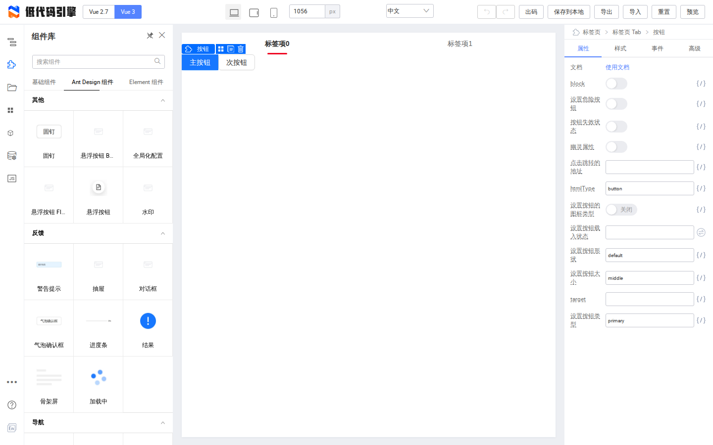

# lowcode-engine-vue

Vue renderer, designer simulator, designer plugins, materials and tooling for
[Alibaba LowCode Engine](https://github.com/alibaba/lowcode-engine), for both
**Vue 2.7** and **Vue 3**.

- Designer: <https://lowcode-vue.pages.dev/> (Vue 3) ·
  <https://lowcode-vue.pages.dev/?vue=2> (Vue 2.7)
- Usage guide (Chinese): <https://wcd.pages.dev/posts/lowcode-engine-vue-guide/>
- Write-up of the design (Chinese): <https://wcd.pages.dev/posts/lowcode-engine-vue/>



One renderer core serves both Vue versions: it is written against the
Composition API that Vue 2.7 and Vue 3 share, and everything that differs
between the two (vnode data, instance internals, mounting, the router) lives
behind a small adapter. The core is `@cdlab996/lowcode-vue-core`;
`@cdlab996/lowcode-vue2` and `@cdlab996/lowcode-vue3` depend on it and
re-export its API with their adapter installed. See
[docs/architecture.md](./docs/architecture.md) and
[docs/design/unified-renderer.md](./docs/design/unified-renderer.md).

## Which package

| You want to                                | Install                                                                                                  |
| ------------------------------------------ | -------------------------------------------------------------------------------------------------------- |
| render low-code pages in a Vue application | `@cdlab996/lowcode-vue3` or `@cdlab996/lowcode-vue2`                                                     |
| render them on a plain page (no bundler)   | the same package's `dist/renderer.umd.js` (`window.LCVueRenderer`)                                       |
| build a designer on LowCode Engine         | the same package's `dist/simulator.umd.js`, the `lowcode-plugin-*` packages and `lowcode-engine-ext-vue` |
| offer a component library in the designer  | a `@cdlab996/lowcode-materials-*` package                                                                |
| turn a schema into a Vite + Vue project    | `@cdlab996/lowcode-code-generator` (API and `lowcode-codegen` CLI)                                       |
| write your own materials                   | `pnpm create @cdlab996/lowcode` (uses `@cdlab996/lowcode-material-builder`)                              |

```
@cdlab996/lowcode-vue-core            renderer, simulator, schema rules (peer: vue, optional)
├─ @cdlab996/lowcode-vue2             Vue 2.7 adapter (peers: vue 2.7, vue-router 3)
├─ @cdlab996/lowcode-vue3             Vue 3 adapter (peers: vue 3.5, vue-router 4 / 5)
└─ @cdlab996/lowcode-code-generator   uses core/schema only
   └─ @cdlab996/lowcode-plugin-code-generator
```

The other plugins, the materials, the material builder and the scaffold
depend on none of them. `@cdlab996/lowcode-vue-core` is rarely installed
directly: the two distributions re-export all of it. Every public package is
released under the same version.

## Render a schema

```bash
pnpm add @cdlab996/lowcode-vue3 vue   # or @cdlab996/lowcode-vue2 with Vue 2.7
```

```ts
import {
  buildComponents,
  getAdapter,
  Renderer,
} from '@cdlab996/lowcode-vue3/runtime'

// libraryMap: package name -> UMD global; componentsMap: the schema's components
const components = buildComponents(libraryMap, componentsMap)
getAdapter().mount(
  Renderer,
  { schema, components },
  document.getElementById('app')!,
)
```

See [packages/renderer/vue3](./packages/renderer/vue3) (same API in
[vue2](./packages/renderer/vue2)).

## Renderer packages

`@cdlab996/lowcode-vue2` and `@cdlab996/lowcode-vue3` expose the same API:

| Entry                   | Content                                                                                                                |
| ----------------------- | ---------------------------------------------------------------------------------------------------------------------- |
| `.`                     | `Renderer`, `rendererConfig`, `useRendererContext`, `buildComponents`, `AssetLoader`, `createSimulatorRenderer`, types |
| `./runtime`             | the same without the designer simulator (no vue-router)                                                                |
| `./designer`            | `setupDesignerEnvironment(project, { vue })` for the designer page (no Vue import)                                     |
| `dist/renderer.umd.js`  | browser bundle for preview pages: the `./runtime` API as `window.LCVueRenderer`                                        |
| `dist/simulator.umd.js` | designer canvas bundle: `window.LCVueRenderer` plus `window.SimulatorRenderer`                                         |
| `dist/simulator.css`    | canvas styles                                                                                                          |

`vue` and `vue-router` (3.6 for Vue 2.7; 4.2+ or 5 for Vue 3, the repository
uses 5) are peer dependencies; the UMD bundles read Vue from `window.Vue`;
only the simulator bundle includes vue-router.

`initProps` and `initEmits` declare real props and emits: a schema that uses
them renders through its own component type, so a low-code component
receives props and its `this.$emit(...)` reaches the parent's listeners.

Schemas support Page, Block and Component roots, `state`, `methods`,
`dataSource`, `css`, i18n, every Vue lifecycle name (plus the React names),
route guards, and the option hooks written by the Vue source panel:
`initModule`, `initProps`, `initEmits`, `initData`, `initComputed`,
`initWatch`, `initProvide`, `initInject` and `setup`.

## Material projects

`@cdlab996/create-lowcode` creates a material project (an example SFC
component and its meta, built by the material builder) for Vue 2.7 or Vue 3:

```bash
pnpm create @cdlab996/lowcode my-materials --vue 3
```

See [packages/tools/create-lowcode](./packages/tools/create-lowcode).

## Layout

```
packages/
  renderer/
    core/                 @cdlab996/lowcode-vue-core (renderer + simulator core, schema rules)
    vue2/                 @cdlab996/lowcode-vue2  (Vue 2.7 adapter, depends on core)
    vue3/                 @cdlab996/lowcode-vue3  (Vue 3 adapter, depends on core)
  plugins/                designer plugins (React), Vue-version independent
    code-generator/       @cdlab996/lowcode-plugin-code-generator (出码 button)
    directive-loading/    @cdlab996/lowcode-plugin-directive-loading
    engine-ext-vue/       @cdlab996/lowcode-engine-ext-vue (setters and binding dialogs)
    manual/               @cdlab996/lowcode-plugin-manual
    set-doc-url/          @cdlab996/lowcode-plugin-set-doc-url
    vue-code-editor/      @cdlab996/lowcode-plugin-vue-code-editor
  materials/              component materials
    antd-vue1/            @cdlab996/lowcode-materials-antd-vue1   (Vue 2.7)
    element-ui/           @cdlab996/lowcode-materials-element-ui  (Vue 2.7)
    vant2/                @cdlab996/lowcode-materials-vant2       (Vue 2.7)
    antd-vue4/            @cdlab996/lowcode-materials-antd-vue4   (Vue 3)
    element-plus/         @cdlab996/lowcode-materials-element-plus (Vue 3)
    vant4/                @cdlab996/lowcode-materials-vant4       (Vue 3)
  tools/
    code-generator/       @cdlab996/lowcode-code-generator (schema -> Vite + Vue project)
    material-builder/     @cdlab996/lowcode-material-builder (lowcode-material CLI)
    create-lowcode/       @cdlab996/create-lowcode (material project scaffold)
  tsconfig/               @cdlab996/lowcode-tsconfig (shared tsconfig presets, private)
apps/
  designer/               designer app; `?vue=2` / `?vue=3` selects the version
e2e/                      Playwright checks of the designer build
scripts/
  materials/              material meta generator, docs fetcher, screenshots
docs/
  architecture.md         package map and data flow
  design/                 design notes (unified renderer)
  task/, plan/            task and plan tracking (see AGENTS.md)
```

Every package has its own README.

## Development

```bash
pnpm install   # Node >= 24.15, pnpm 12; also builds every package
pnpm dev       # designer (needs nsl); open it with ?vue=2 or ?vue=3
pnpm lint && pnpm lint:type && pnpm test
```

[CONTRIBUTING.md](./CONTRIBUTING.md) covers the development loop, the
scripts, the tests, the material meta generator, CI, releases and deploying
the designer. [AGENTS.md](./AGENTS.md) holds the rules for coding agents.

## License

[MIT](./LICENSE)
